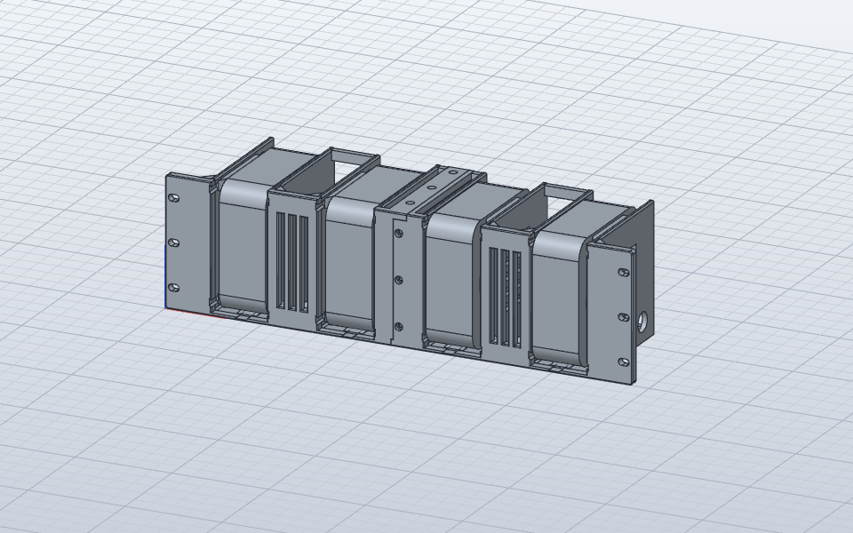

# Mac mini Rack Mount

3D-printable 19" 3U rack mount for four Mac mini (M4) standing upright. Each Mac sits in a cradle on TPU strips that damp vibration and hold it in place.

## Parts

| File | Material | Qty |
| --- | --- | --- |
| `stl/holder_left.stl` | PETG | 1 |
| `stl/holder_right.stl` | PETG | 1 |
| `stl/tpu_floor_strip_4x.stl` | TPU 95A | 4 |
| `stl/tpu_intake_strip_8x.stl` | TPU 95A | 8 |
| `stl/tpu_top_strip_8x.stl` | TPU 95A | 8 |

The STLs are already in print orientation. Each holder half is 249.3 mm wide and fits a 250 × 250 mm bed.

`cad/` has the parametric SolidCraft model and a STEP assembly with the Macs.

## Hardware

- 9× M4×10 socket head screws
- 9× M4 heat-set inserts (5.6 mm hole)
- 6× M6 rack screws with cage nuts

## Assembly

1. Melt the heat-set inserts into the holes for them.
2. Join the two halves with the M4 screws (top, bottom, front).
3. Slide the TPU strips into the dovetail grooves from the front until they click in.
4. Mount in the rack and slide in the Macs. Each Mac goes in with its bottom (air intake) towards the vented cradle wall. The right two face the other way, so no Mac draws air against the center joint.

The Mac mini's foot ring and power button position are estimates. Check the fit with one Mac before printing everything.
