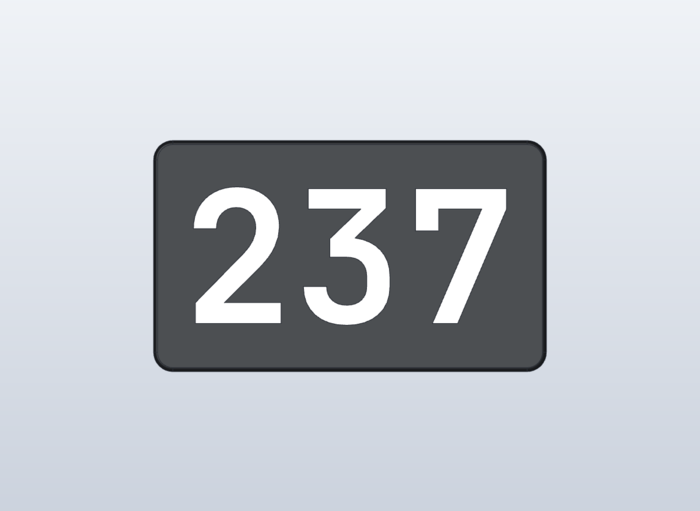
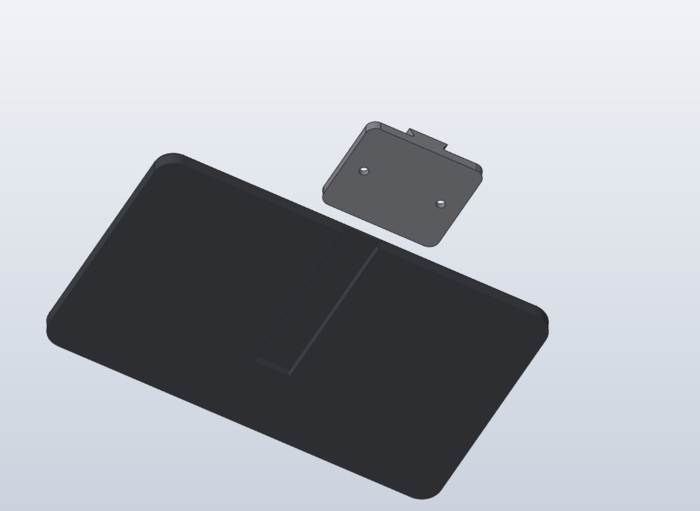

# eMudhra keys

Wall signs of the eight private keys of eMudhra's intermediate CA certificates. In October 2026 they turned out to be tiny numbers instead of random 384-bit values, all below 256: 4, 56, 66, 115, 155, 156, 230 and 237 ([The Register](https://www.theregister.com/security/2026/10/20/indian-certification-authority-emudhras-private-keys-compromised-one-of-them-was-the-number-4/5304312), [CSO Online](https://www.csoonline.com/article/4238338/google-mozilla-revoke-emudhra-intermediates-after-private-key-compromise.html)).

Each sign is two parts: a plaque with the raised number, and a wall mount. The mount is the same for every key: a plate held by two screws, with a dovetail rail running up the wall. The plaque has the matching slot in its back, open at the bottom: put it on above the mount and slide it down until it rests on the rail.

## Parts

| Key | Plaque | Design | Plate in `orca/eMudhra_Keys.3mf` | Time | PETG HF black + white |
| --- | --- | --- | --- | --- | --- |
| 4 | 88 × 120 mm | `cad/4.solidcraft` | 1 | 1h 23m | 48.7 g + 2.9 g |
| 56 | 146 × 120 mm | `cad/56.solidcraft` | 2 | 1h 54m | 71.0 g + 5.8 g |
| 66 | 146 × 120 mm | `cad/66.solidcraft` | 3 | 1h 53m | 71.1 g + 5.6 g |
| 115 | 204 × 120 mm | `cad/115.solidcraft` | 4 | 2h 23m | 94.0 g + 7.8 g |
| 155 | 204 × 120 mm | `cad/155.solidcraft` | 5 | 2h 24m | 93.7 g + 8.2 g |
| 156 | 204 × 120 mm | `cad/156.solidcraft` | 6 | 2h 24m | 93.8 g + 8.0 g |
| 230 | 204 × 120 mm | `cad/230.solidcraft` | 7 | 2h 25m | 93.5 g + 8.7 g |
| 237 | 204 × 120 mm | `cad/237.solidcraft` | 8 | 2h 23m | 93.9 g + 7.9 g |

Every plate holds one plaque and one mount; times and weights include the mount. All eight: about 17.5 h, 660 g black and 55 g white (OrcaSlicer estimate).

## Print

Bambu Lab P1S, 0.20 mm Standard, Bambu PETG HF on the Textured PEI Plate, AMS with black in slot 1 and white in slot 2 (assumption: the colours; any two work). Each plaque is one object of two parts, the plaque on filament 1 and the digits on filament 2, so it changes colour only for the 8 digit layers. The plaque prints back down, the mount back down with the rail up. No supports, no brim; the only bridge is the slot's ceiling (21 mm).

STLs in `stl/`: `<key>_plaque.stl` and `<key>_number.stl` in the same frame, `mount.stl` once.

## Hardware

Per sign: 2 countersunk wood screws 4 mm (e.g. 4 × 30 mm) and 2 wall plugs to suit the wall.

## Mounting

1. Hold the mount on the wall with the rail vertical and mark the two holes, 40 mm apart side by side. Level them: the plaque hangs as level as the holes are.
2. Drill, plug and screw the mount on.
3. Put the plaque on the wall 85 mm above its final place, the slot over the rail's top end, and slide it down until it stops. It hangs centred on the mount, 5 mm off the wall.

## Model

`tools/build.py` is the source of truth: it writes the SolidCraft command list for one key, with plaque, digits and mount in their hanging position. Every length is a user parameter with a comment. Font: JetBrains Mono Bold (JetBrainsMono Nerd Font, installed on this machine), 70 mm high, 1.6 mm raised; `make.py` centres the digits by their measured outline. The slot is the rail's section offset by 0.25 mm on every face, with a chamfered mouth that clears the 1 mm rounding at the rail's root.

`tools/make.sh` rebuilds `cad/`, `stl/`, `orca/eMudhra_Keys.3mf` and `images/`; it stops on a kernel warning or nudged boolean, on overlapping parts, on digits nearer than 15 mm to the edge, and on an OrcaSlicer error. `tools/live.py` builds one key step by step in a running SolidCraft GUI.
