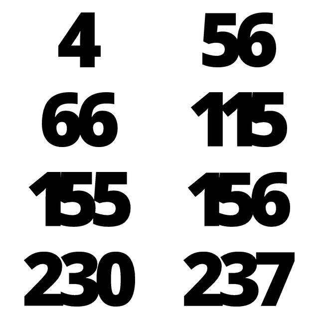
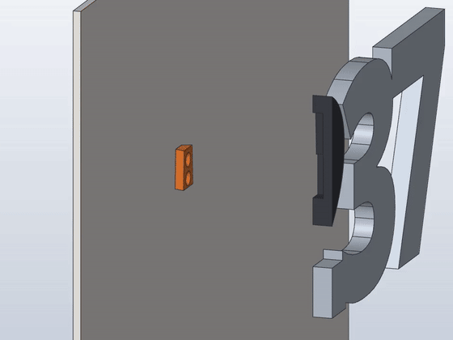

# eMudhra keys

Wall numbers of the eight private keys of eMudhra's intermediate CA certificates. In October 2026 they turned out to be tiny numbers instead of random 384-bit values, all below 256: 4, 56, 66, 115, 155, 156, 230 and 237 ([The Register](https://www.theregister.com/security/2026/10/20/indian-certification-authority-emudhras-private-keys-compromised-one-of-them-was-the-number-4/5304312), [CSO Online](https://www.csoonline.com/article/4238338/google-mozilla-revoke-emudhra-intermediates-after-private-key-compromise.html)).

Each number is two parts: the digits as one solid black piece, and a wall mount hidden behind them. The mount is the same for every key: a short dovetail rail held by two screws. Its plan narrows towards the top, so the number wedges tight as it slides down and hangs level without play, even where the mount sits off the number's centre.

How it goes on (cut open along the rail): the pocket in the number's back takes the rail, then the number slides down until the rail wedges in the dovetail.

## Parts

| Key | Size | Design | Plate in `orca/eMudhra_Keys.3mf` | Time | PETG HF black | Lower screw: from left edge, above bottom edge |
| --- | --- | --- | --- | --- | --- | --- |
| 4 | 89 × 115 mm | `cad/4.solidcraft` | 1 | 44m | 26.6 g | 56 mm, 43 mm |
| 56 | 158 × 118 mm | `cad/56.solidcraft` | 2 | 1h 22m | 55.2 g | 87 mm, 55 mm |
| 66 | 163 × 118 mm | `cad/66.solidcraft` | 3 | 1h 24m | 56.7 g | 91 mm, 55 mm |
| 115 | 205 × 117 mm | `cad/115.solidcraft` | 4 | 1h 32m | 63.6 g | 112 mm, 96 mm |
| 155 | 217 × 117 mm | `cad/155.solidcraft` | 5 | 1h 43m | 71.3 g | 121 mm, 48 mm |
| 156 | 221 × 118 mm | `cad/156.solidcraft` | 6 | 1h 44m | 72.2 g | 121 mm, 48 mm |
| 230 | 240 × 118 mm | `cad/230.solidcraft` | 7 | 1h 54m | 79.8 g | 168 mm, 56 mm |
| 237 | 240 × 118 mm | `cad/237.solidcraft` | 8 | 1h 44m | 72.3 g | 63 mm, 87 mm |

Every plate holds one number and one mount; times and weights include the mount. All eight: about 12 h and 500 g (OrcaSlicer estimate). All numbers are 10 mm thick.

## Print

Bambu Lab P1S, 0.20 mm Standard, Bambu PETG HF black on the Textured PEI Plate. The number prints back down, the mount with its wide side up. No supports, no brim; the only bridges are the ceilings of the pocket and the dovetail (15 mm).

STLs in `stl/`: `<key>.stl` and `mount.stl`.

## Hardware

Per number: 2 countersunk wood screws 3.5 mm (e.g. 3.5 × 30 mm, head 7 mm) and 2 wall plugs for 3.5 mm screws. The holes are 9.5 mm apart, one above the other.

## Mounting

1. Mark where the number's bottom left corner goes. The lower screw goes the distance in the table to the right of it and above it; the upper one 9.5 mm straight above that. Assumption: the number may end up about a millimetre higher or lower, depending on how tight the print came out.
2. Drill, plug and screw the mount on, narrow end up.
3. Put the number on the wall 20 mm above its place, the rail in the pocket in its back, and slide it down until it stops.

## Model

`tools/build.py` is the source of truth: it writes the SolidCraft command list for one key, with number and mount in their hanging position. Every length is a user parameter with a comment. Font: Noto Sans Black (`fonts/`, SIL Open Font License), 115 mm high; each digit is its own text and extrude, placed so its outline overlaps the one before by 5 mm.

`tools/make.sh` rebuilds `cad/`, `stl/`, `orca/eMudhra_Keys.3mf` and `images/numbers.png`. Per key it checks that the digits are one piece, places the slot where it fits inside the digits with 2.5 mm of wall, as near the centre of mass as it can, and stops on a kernel warning or nudged boolean, on number and mount overlapping, and on mounts that differ between the keys. `tools/animate.py` renders `images/mount.mp4` and `images/mount.gif`; `tools/live.py` builds one key step by step in a running SolidCraft GUI.

Slot and rail: dovetail flanks 20° from vertical, plan taper 3° per side. The dovetail part has the rail's own flanks (it wedges there) with 3 mm of room above the rail's top end, 0.25 mm above it; the pocket is 0.25 mm larger than the rail all round. 0.1 mm of slot width moves where it wedges by about 1 mm.
