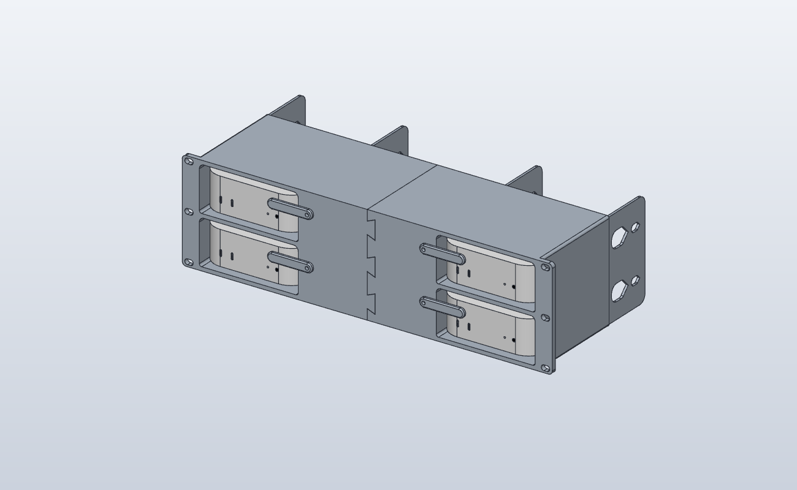
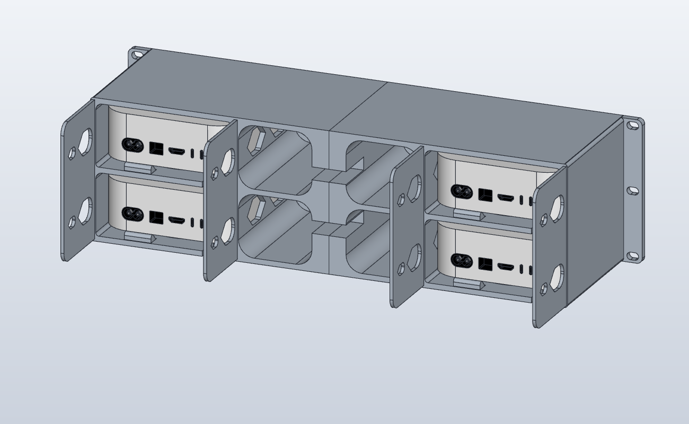

# Mac mini Rack v2

3D-printable 19" 3U rack mount for four Mac mini (M4), in two stacks of two, standing upright on their feet.

## Parts

| File | Material | Qty |
| --- | --- | --- |
| `stl/Rack_links.stl` | PETG | 1 |
| `stl/Rack_rechts.stl` | PETG | 1 |
| `stl/Riegel.stl` (latch) | PETG | 4 |

All parts are in print orientation and need no supports. `orca/MacMini_Rack.3mf` is the OrcaSlicer project for a Bambu Lab P1S: plate 1 the left half (about 22.6 h, 1006 g), plate 2 the right half with the four latches (about 21.9 h, 967 g).

## Hardware

- 6× M6 rack screws with cage nuts
- 4× M4×16 screws with washers (latches; they cut their own thread)

## Assembly

1. Hold the right half behind the left half and slide it forwards onto the dovetails until it stops (its slots are closed at the back). The dovetails have 0.25 mm clearance on the flanks and the tip (`dt_c`); the closed slot end is the stop.
2. Screw it into the rack. The rails keep the halves from sliding apart.
3. Slide each Mac in from the front until it touches the rear stop.
4. Screw on the latches. Turned towards the Mac they hold it in, turned the other way it slides out.

Cables: the outer walls and the walls beside the bays continue 70 mm behind the body, each with a large (22 × 32 mm) and a small (10 × 16 mm) cable hole per level. The large ones are meant for HDMI, power and LAN plugs; the plug sizes are not measured. Slots in the walls beside the bays lead into the free space next to each stack. Notches open to the back run through both centre walls, so plugged cables drop in from behind.

Power button: each shelf has a round-ended slot under the Mac's rear left corner, open to the back. The button position is an estimate (`btn_x`); check it against a real Mac before printing.

## Model

`cad/rack.solidcraft` is the parametric SolidCraft design. Every length is a user parameter, e.g. `fit` (clearance around a Mac), `dt_c` (dovetail clearance), `plate_t`, `wall_t`. `tools/make.sh` rebuilds the design, the STLs in print orientation and the 3MF from `tools/build.py` (needs `solidcraft-cli` and `orca-slicer` on the PATH). Change parameters in `build.py`, then run `make.sh`, so the design and print files stay in step. `tools/make.sh --macs MAC.step` also writes `work/rack_with_macs.solidcraft` with four Mac minis to check the fit. The Mac mini model is third-party and not included; the bays are sized from a 127 × 127 × 50.8 mm M4 model with its foot 6.35 mm high. `tools/check_print.py` lists the faces of an STL that need support or bridging.
