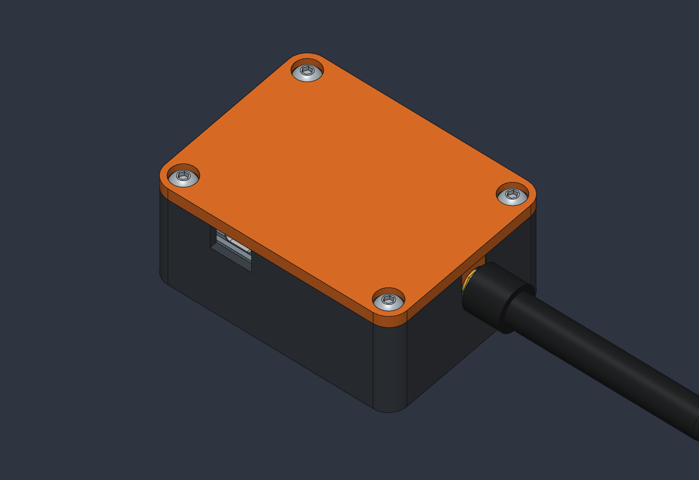
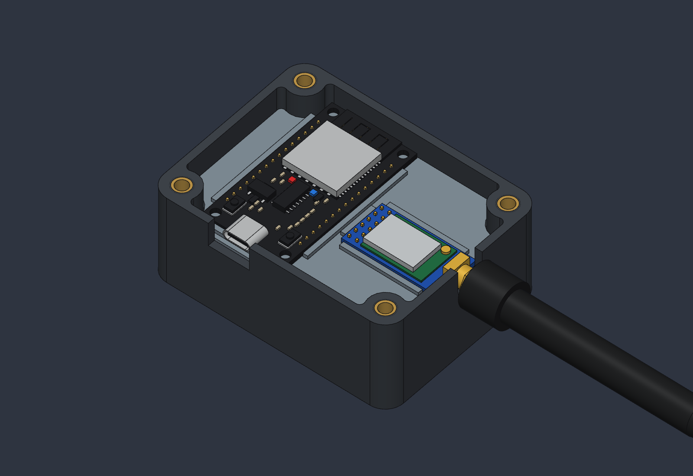

# Meshtastic node

Case for a USB-C powered Meshtastic node: an ESP32 DevKit V1 (30 pins, USB-C) wired with Dupont jumpers to a DX-LR30-900M22S (SX1262) radio on its DX-PJ27 carrier. No battery. 79 × 60 × 34.5 mm without the antenna; not waterproof.

## Parts

| File | Material | Qty |
| --- | --- | --- |
| `stl/base.stl` | TPU for AMS (68D) | 1 |
| `stl/plate.stl` (mounting plate) | TPU for AMS (68D) | 1 |
| `stl/lid.stl` | TPU for AMS (68D) | 1 |

All parts are in print orientation and need no supports. `orca/meshtastic-node.3mf` is the OrcaSlicer project for a Bambu Lab P1S with a 0.8 mm nozzle, all three parts on one Textured PEI plate: about 1 h 20 min, 74 g. The flattened profiles are in `orca/profiles/`.

## Hardware

- 4× M4 × 8.1 heat-set inserts (outer Ø about 6.3 mm), in Ø5.6 mm holes
- 4× M4 × 10 button head screws (ISO 7380)
- 11× female–female Dupont wires; cut lengths in the build plan

## Design

- The four insert holes sit in the corners, concentric with the outer corner radius. The corner columns blend into the walls with drawn tangent arcs.
- Both boards lie flat in low pockets on a 2.4 mm mounting plate. The plate rests on a 1.5 mm ledge in the wall. Windows in the plate let the header spacers and plugged Dupont housings through; the wires run on the floor below.
- The ESP32 is turned 90°, so USB-C exits the front long wall and all four corners stay free for the screws.
- The SMA connector leaves through a slot that is open at the top; a tongue on the lid closes it. This lets the plate with wired boards drop in from above.
- The lid has a 1.6 × 2 mm locating rim that follows the walls and wraps the corner columns (0.3 mm play). Fingers on the lid press 0.3 mm into both boards, so the TPU lid clamps them.

## Assembly

The German build plan with wiring diagram, cut lengths, assembly order and checks is in [`docs/bauplan/bauplan.pdf`](docs/bauplan/bauplan.pdf). Short version:

1. Press the four inserts into the corner columns.
2. Plug all 11 wires onto both boards outside the case.
3. Lay the boards into their plate pockets, plugs through the windows.
4. Lower the plate into the base: SMA into its slot, USB-C to the front opening.
5. Put the lid on and screw in the four M4 screws.
6. Screw on the antenna.

Wiring and the unverified RF switch (RXEN/TXEN): [`docs/wiring.md`](docs/wiring.md). Check it before powering up.

## Not verified

- Whether heat-set inserts hold in TPU: print one corner column as a test first.
- Board dimensions, hole and pin positions are partly estimated from photos; test-fit the pockets and the 0.3 mm play with real parts.
- The wire paths are idealised.

## Model

`cad/meshtastic-node.sc` is the SolidCraft 0.30.1 assembly with every board, chip, wire, insert and screw. The boards are linked from `cad/parts/` (their `.json` files list dimensions, pins and which values are estimates). `cad/batches/v2/` holds the commands the design was built from, in order; `make_batches.py` and `profiles.py` write the case steps 04–07. `tools/route_wires_v2.py` searches the wire paths (`cad/batches/v2/routes.json`). `tools/sc PORT TOOL '<json>'` sends one command to a running SolidCraft window (`SolidCraft --control PORT`).
